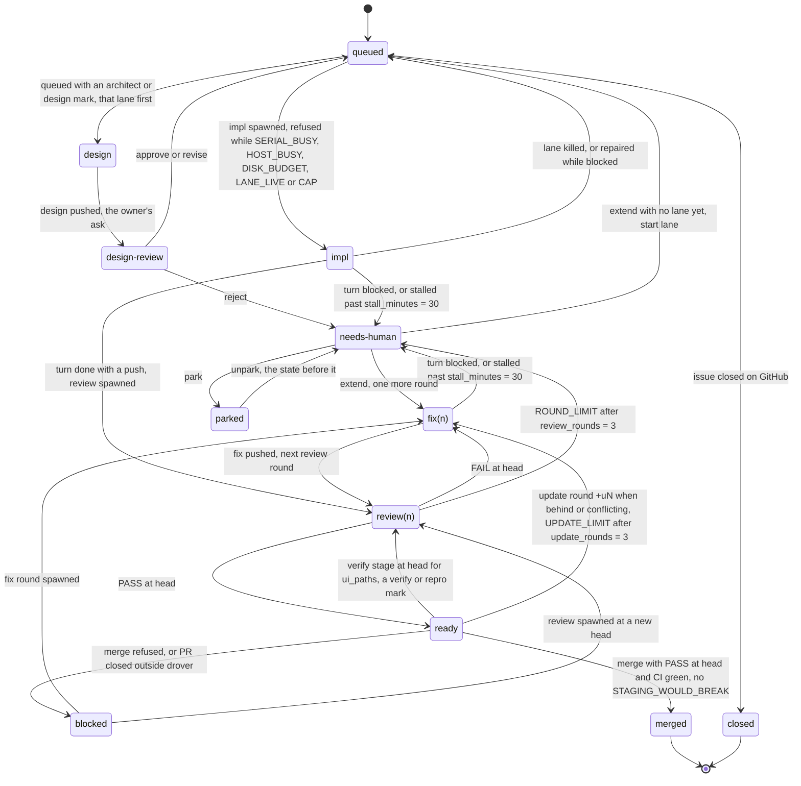

# Workflow

Generated by `drover diagram` from the code's tables (default `[limits]`); CI fails when this file differs.
`drover diagram --live [FLEET]` adds each state's issues (of FLEET, else every fleet) at the config's values.

## Issue states

## Timers and the drive pass

```mermaid
flowchart TD
    j0["dev.drover.tick: drover tick"] --> t0
    j1["dev.drover.fast: drover drive --fast"] --> d0
    t0["check"] --> t1
    t1["drive"] --> t2
    t2["clean"] --> t3
    t3["trim"] --> t4
    t4["lesson"] --> t5
    t5["hotspots"]
    d0["read log, host sample"] --> d1
    d1["disk budget"] --> d2
    d2["roots, redeliver"] --> d3
    d3["look, orphans"] --> d4
    d4["repair, outbox"] --> d5
    d5["PR reads, gates, steps"] --> d6
    d6["spawns"] --> d7
    d7["backlog, checkpoint"]
    t1 --> d0
    other["other timers: serve, hosts, store"]
    j0 -.- k_slow_secs(["slow_secs = 300"])
    j1 -.- k_fast_secs(["fast_secs = 60"])
    t0 -.- k_stall_minutes(["stall_minutes = 30"])
    t0 -.- k_ask_default_minutes(["ask_default_minutes = 30"])
    t0 -.- k_ask_waiting_minutes(["ask_waiting_minutes = 30"])
    t0 -.- k_ask_expire_hours(["ask_expire_hours = 24"])
    t0 -.- k_outbox_stale_minutes(["outbox_stale_minutes = 5"])
    t0 -.- k_acp_start_minutes(["acp_start_minutes = 3"])
    t0 -.- k_idle_reap_minutes(["idle_reap_minutes = 10"])
    t0 -.- k_done_close_minutes(["done_close_minutes = 5"])
    t0 -.- k_idle_merged_minutes(["idle_merged_minutes = 15"])
    t0 -.- k_token_refresh_minutes(["token_refresh_minutes = 30"])
    t1 -.- k_pass_max_secs(["pass_max_secs = 120"])
    d1 -.- k_shed_read_millis(["shed_read_millis = 300"])
    d1 -.- k_worktree_budget_gb(["worktree_budget_gb = 25.0"])
    d1 -.- k_build_budget_gb(["build_budget_gb = 20.0"])
    d2 -.- k_host_offline_minutes(["host_offline_minutes = 15"])
    d3 -.- k_ssh_quick_secs(["ssh_quick_secs = 5"])
    d3 -.- k_ssh_call_secs(["ssh_call_secs = 20"])
    d3 -.- k_import_max_age_hours(["import_max_age_hours = 24"])
    d5 -.- k_webhook_poll_minutes(["webhook_poll_minutes = 10"])
    d5 -.- k_silent_minutes(["silent_minutes = 10"])
    d5 -.- k_ci_start_minutes(["ci_start_minutes = 10"])
    d5 -.- k_gate_check_minutes(["gate_check_minutes = 30"])
    d5 -.- k_review_rounds(["review_rounds = 3"])
    d5 -.- k_update_rounds(["update_rounds = 3"])
    d6 -.- k_max_parallel_spawns(["max_parallel_spawns = 6"])
    d6 -.- k_spawn_pending_max_secs(["spawn_pending_max_secs = 300"])
    d6 -.- k_respawn_max(["respawn_max = 3"])
    d6 -.- k_respawn_window_minutes(["respawn_window_minutes = 60"])
    d6 -.- k_fallback_rest_minutes(["fallback_rest_minutes = 60"])
    d6 -.- k_overflow_after_minutes(["overflow_after_minutes = 10"])
    d7 -.- k_rotate_mb(["rotate_mb = 20"])
    other -.- k_transcript_days(["transcript_days = 30"])
    other -.- k_runtime_down_minutes(["runtime_down_minutes = 30"])
    other -.- k_ssh_connect_secs(["ssh_connect_secs = 10"])
    other -.- k_access_probe_secs(["access_probe_secs = 30"])
    other -.- k_db_busy_secs(["db_busy_secs = 60"])
    other -.- k_db_retry_millis(["db_retry_millis = 10"])
    other -.- k_cloud_idle_stop_minutes(["cloud_idle_stop_minutes = 20"])
    other -.- k_notify_secs(["notify_secs = 15"])
    other -.- k_proxy_connect_secs(["proxy_connect_secs = 1"])
    other -.- k_service_call_secs(["service_call_secs = 2"])
    other -.- k_disk_probe_secs(["disk_probe_secs = 2"])
    other -.- k_disk_sick_secs(["disk_sick_secs = 300"])
    other -.- k_disk_trust_secs(["disk_trust_secs = 60"])
    other -.- k_lane_read_secs(["lane_read_secs = 5"])
    other -.- k_poll_millis(["poll_millis = 20"])
    other -.- k_tick_beat_secs(["tick_beat_secs = 60"])
    other -.- k_orchestrator_idle_minutes(["orchestrator_idle_minutes = 30"])
    other -.- k_orchestrator_change_minutes(["orchestrator_change_minutes = 30"])
    other -.- k_serve_shed_secs(["serve_shed_secs = 5"])
    other -.- k_serve_remote_secs(["serve_remote_secs = 10"])
    other -.- k_serve_host_secs(["serve_host_secs = 10"])
    other -.- k_serve_heartbeat_secs(["serve_heartbeat_secs = 15"])
    other -.- k_serve_handover_secs(["serve_handover_secs = 300"])
    other -.- k_slo_api_minutes(["slo_api_minutes = 10"])
    other -.- k_slo_idle_minutes(["slo_idle_minutes = 20"])
    other -.- k_slo_tick_minutes(["slo_tick_minutes = 10"])
```

